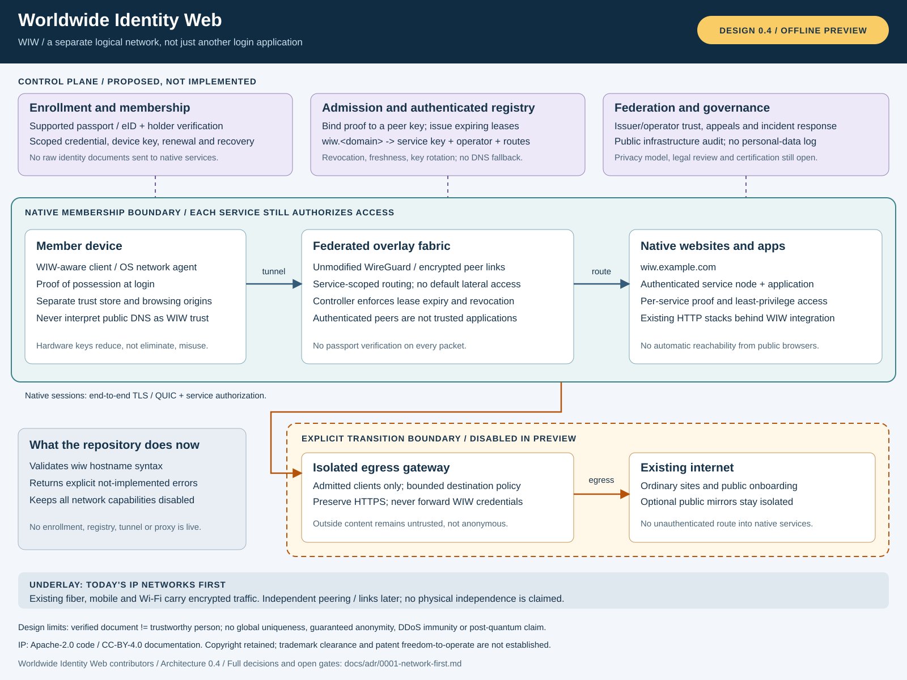

# Worldwide Identity Web (WIW)

**An identity-gated alternative network. An open design and developer preview,
not a deployed internet, identity provider, or recognized standard.**

WIW proposes a separate, federated network with its own admission policy,
service namespace and routing. Participants would enroll using supported
government identity documents, then authenticate with device-bound credentials.
Services would receive scoped proofs, not passports. Network membership would
never replace service authorization.

The first network phase would use today's internet as an encrypted underlay.
Independent operator peering and links are later possibilities. This is not
simply a login button on existing websites, but neither is it a physically
independent internet today.



[Architecture and decisions](docs/adr/0001-network-first.md) |
[Developer preview](docs/developer-preview.md) |
[IP and licensing](docs/ip-policy.md) |
[Contributing](CONTRIBUTING.md)

## What exists today

| Component | This repository |
| --- | --- |
| WIW address syntax | Tested ASCII hostname parser: `wiw.example.com` |
| TypeScript SDK | Offline API skeleton; privileged calls throw explicit errors |
| Rust core | Tested denial-only membership, peer provisioning and gateway stubs |
| Network / transition gateway | Disabled design profiles; no listener, VPN or proxy |
| Passport, biometrics, credentials | **Not implemented. Do not supply real identity data.** |
| Naming registry, routing, service hosting | **Not implemented.** No site becomes reachable by adding `wiw.` |
| Post-quantum, onion routing, attestation | Research candidates, not security guarantees |

No sample credential is accepted as real. The SDK and Rust crate are separate
stubs, not language bindings to one another. Nothing installs a network adapter,
changes DNS or firewall settings, or opens a public server.

## Try the offline preview

Requirements: Node.js 24+ and npm. Rust stable plus the platform's linker is
needed for the independent Rust tests.

```shell
npm ci
npm test
npm run demo
cargo test --workspace
```

The demo canonicalizes `WIW.Example.test`, then reports
`IDENTITY_NOT_IMPLEMENTED`, `NAMING_NOT_IMPLEMENTED`,
`NETWORK_NOT_IMPLEMENTED` and `GATEWAY_DISABLED`. Those are expected denials,
**not a successful enrollment or connection**.

## Addresses: `wiw.<domain>`

All WIW-native websites are intended to have a `wiw.<domain>` address. A
WIW-aware client must resolve it through an authenticated WIW registry, with
**no public-DNS fallback**.

`wiw.` is an ordinary, unreserved DNS label. A normal browser can resolve
`wiw.example.com` on the existing internet; that does not make it a WIW site.
The eventual client must visibly distinguish these contexts. The preview
validates syntax only and cannot claim domain ownership, reserve names or
intercept ordinary browsing.

Existing websites remain outside the membership boundary. An explicit,
isolated transition gateway is planned for outbound access. Public mirrors
would be separate, opt-in, untrusted services, never a path for unauthenticated
visitors into the native network.

## Security principles

- Passport authenticity is evidence about a document, not proof of good intent
  or global one-person-one-account uniqueness.
- Use established cryptographic implementations. Keep WireGuard unmodified;
  admission, leases and revocation belong in a separate control plane.
- Use scoped, short-lived proofs and per-service authorization. Do not broadcast
  a person's identity across routers or applications.
- Keep government documents and biometrics out of repositories, logs and
  service APIs. Any future live enrollment requires a reviewed privacy and
  legal basis.
- Gateways, verified members and devices can be compromised. Never advertise
  guaranteed anonymity, immunity to DDoS, or automatic legal compliance.

## Preview milestones

1. **This scaffold:** review architecture, threat assumptions and API boundaries.
2. **Specification:** choose credential, naming, recovery and revocation protocols;
   define interoperable messages and test vectors.
3. **Local testnet:** synthetic identity fixtures, authenticated registry, isolated
   service nodes, admission-controlled WireGuard and explicit gateway separation.
4. **External review:** privacy assessment, protocol and implementation audits,
   governance, name disputes, incident response and cross-client conformance.
5. **Limited pilot:** only after the above gates; real identity documents must
   not be used in the current preview.

Web and app developers, network operators and identity/privacy researchers are
welcome to contribute. APIs and the proposed protocol are unstable.

## Rights and branding

Code: [Apache-2.0](LICENSES/Apache-2.0.txt).
Documentation/specification and diagrams: [CC-BY-4.0](LICENSES/CC-BY-4.0.txt).
See [LICENSE](LICENSE), [contributor terms](CLA.md) and
[brand policy](TRADEMARKS.md).

Copyright ownership is retained by the respective authors. These open licenses
permit reuse; they do not reserve exclusive use of the idea. No trademark
registration, patent clearance, legal certification, or official standards-body
endorsement is claimed.
